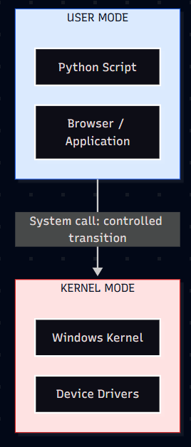
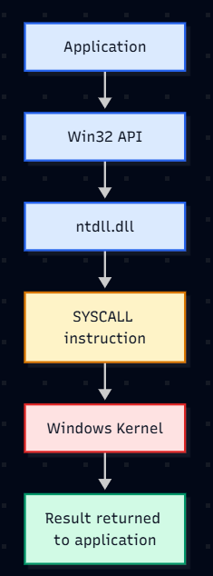
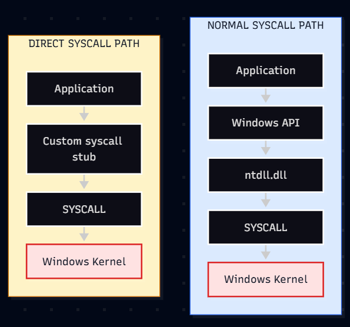
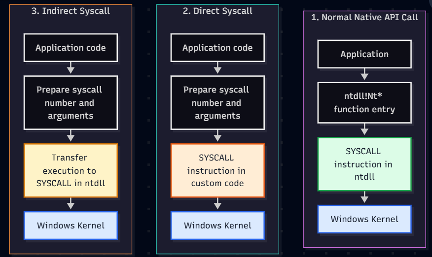
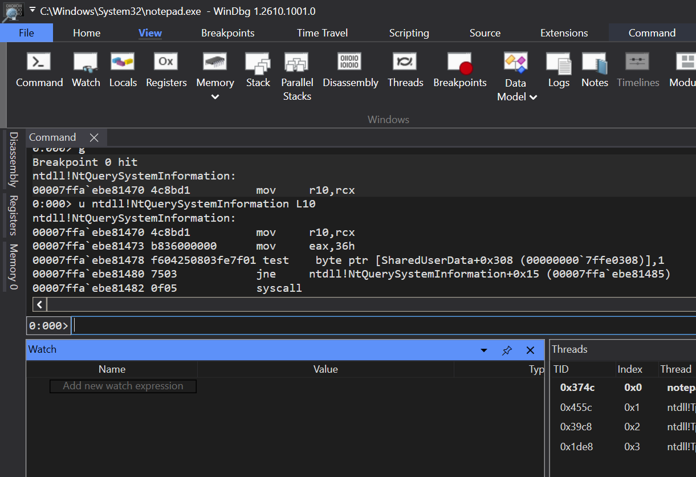

# Beyond the Syscall: Direct vs. Indirect Syscalls on Windows


When you open an application, create a file, or launch another process, Windows performs a lot of work behind the scenes. Your application makes a request, Windows processes it, and the operation eventually happens.


But here is an interesting question: **how does an ordinary application ask the Windows kernel to do something on its behalf?**


This is where system calls, commonly called **syscalls**, come into the picture.


Syscalls are an important concept in malware analysis because some malware authors use them to interact with Windows in ways that differ from the usual API call patterns. Understanding them also helps explain why security products monitor more than just the Windows APIs an application calls.


Let's start with the basics.


## 1. User mode and kernel mode


Think of Windows as a large office building.


Employees can work in their own offices, use approved equipment, and request services. However, only authorised personnel can enter restricted areas containing sensitive equipment and infrastructure.


The operating system follows a similar idea.


### User mode: Where applications normally run


User mode is where most ordinary applications execute. Your browser, text editor, Python scripts, and many background applications run here.


Applications operate with restrictions. A process generally cannot freely access another process's private memory, directly control hardware, or execute privileged CPU instructions.


These restrictions help prevent a bug in one application from crashing or compromising the entire system.


### Kernel mode: Where the operating system manages the machine


Kernel mode is a highly privileged execution mode used by the Windows kernel and other trusted operating-system components.


The kernel manages resources such as process scheduling, virtual memory, and access to system resources. Device drivers also commonly execute in kernel mode.


Returning to our office analogy:


- **User mode:** You work in your own office and request services when needed.

- **Kernel mode:** The restricted operations area where authorised system components perform privileged work.

- **System call:** The formal route through which an application requests a service from the operating system.


The analogy isn't perfect, but it gives us a useful starting point.


An important distinction: **user mode and kernel mode describe execution privilege, not whether a user is an administrator.** Even an administrator's ordinary application generally runs in user mode. Administrative permissions and CPU execution mode are different concepts.


### User Mode and Kernel Mode





## 2. What exactly is a syscall?


A system call is a controlled mechanism that allows a program to request a service from the operating system kernel.


For example, an application might need to open a file, create a process, or allocate memory. Rather than directly performing privileged operations, it requests the appropriate operating-system service.


Think of ordering food at a restaurant.


You tell the waiter what you want. The waiter communicates the request to the kitchen, the kitchen checks what can be prepared, and the food comes back to you.


You don't walk into the kitchen and operate the equipment yourself.


In this analogy:


- Your application is the customer.

- The Windows API is part of the ordering interface.

- The system-call mechanism carries the request across the boundary.

- The kernel performs the relevant work, subject to its checks.


Windows applications often use familiar Win32 APIs, such as `CreateFileW` or `CreateProcessW`. These APIs may eventually rely on lower-level native services, but not every API call results in a syscall. Some operations are completed entirely in user mode, and some APIs involve other system components.


This distinction matters when analysing malware: **an API call, a native API call, and a system call are related concepts, but they are not interchangeable terms.**


## 3. How does Windows transition into kernel mode?


Let's look at a simplified path for an operation that requires a kernel service.


```text

Application
    |
    v
Win32 API
    |
    v
ntdll.dll
    |
    v
SYSCALL instruction
    |
    v
Windows kernel
    |
    v
Result returned to the application

```


This is a conceptual path, not a rule that every Windows API follows.


### Step 1: The application calls an API


Suppose an application needs to query information from Windows. It might call a documented Win32 API or, in some cases, a native API exposed through `ntdll.dll`.


### Step 2: The request reaches ntdll.dll


`ntdll.dll` is a core Windows user-mode library. It contains the Native API routines commonly used to reach Windows system services.


You will encounter function names such as:


- `NtQuerySystemInformation`

- `NtAllocateVirtualMemory`

- `NtProtectVirtualMemory`

- `NtCreateFile`


These functions provide interfaces to native operating-system services. Their availability, supported usage, and documentation vary; not all are intended as stable application interfaces.


### Step 3: A system-call instruction transfers execution


On modern x64 Windows systems, native syscall stubs commonly use the CPU's `SYSCALL` instruction to request a kernel service.


A simplified stub may look like this:


```asm
mov r10, rcx
mov eax, <service_number>
syscall
ret
```


Let's break it down:


- `mov r10, rcx` — preserves the first argument in the register arrangement expected by the x64 syscall convention.

- `mov eax, \<service_number>` — places the system-service number in `EAX`.

- `syscall` — invokes the processor's system-call transition mechanism.

- `ret` — returns from the stub after the syscall returns.


The service number above is a placeholder. Actual values vary between Windows versions and builds, and the precise stub can differ.


The `SYSCALL` instruction doesn't mean the application can suddenly do anything it wants. The CPU transitions according to the system's configured mechanisms, and the kernel determines how to handle the request.


### What happens to the arguments and return value?


A syscall is more than a jump into kernel mode. The calling code must also supply the arguments expected by the requested service.


On x64 Windows, a native syscall stub commonly places the service number in `EAX` and prepares the required argument registers before executing `SYSCALL`. The exact argument layout depends on the function and calling convention.


The kernel processes the request and returns a status or result to the caller. Native APIs commonly use `NTSTATUS` values to indicate success or failure, although the specific return type depends on the service.


For a malware analyst, this matters because identifying the syscall name is only the beginning. Understanding its arguments and return value helps reveal what the program attempted to do and whether the operation succeeded.


### Step 4: The kernel handles the request


The kernel processes the requested service and performs relevant validation and access checks. A request may succeed or fail depending on its arguments, permissions, process state, and other conditions.


The result is then returned to the calling code.


### Diagram 2 — Syscall Flow





## 4. What makes direct syscalls interesting to malware analysts?


Normally, a program can use the standard Windows API path. Security tools may observe activity at different points along that path, including certain user-mode API calls.


Some malware authors try to avoid particular user-mode monitoring hooks by invoking the syscall mechanism directly instead of following the usual route through a hooked native API stub.


This is commonly referred to as **direct syscall usage**.


### Why would malware do this?


Imagine a building where security staff monitor the main reception desk. Most visitors enter through reception, so the staff have a convenient place to observe activity.


A visitor who finds another permitted entrance might avoid that particular checkpoint. However, that doesn't mean they become invisible to every camera, access-control system, or security guard in the building.


User-mode API hooks can work similarly. If a security product relies on a particular user-mode hook, avoiding that hook may reduce visibility into the specific activity it monitors there.


But other visibility may remain, including kernel-level telemetry, process and memory behaviour, event tracing, and other security sensors.


Direct syscalls are therefore a technique worth understanding during analysis, not a guarantee of stealth.


### What direct syscalls do not mean


A few common misconceptions are worth clearing up:


- **They do not automatically provide administrator or SYSTEM privileges.** The syscall uses the security context and permissions of the calling process.

- **They do not automatically exploit the kernel.** Calling a legitimate system service is different from exploiting a kernel vulnerability.

- **They do not bypass every EDR.** Detection depends on the product, its telemetry, its configuration, and the behaviour being monitored.

- **They are not inherently malicious.** Native system services are part of normal Windows operation; context determines whether activity is suspicious.


A useful analyst question is not simply, "Did this program make a direct syscall?" It is, "What operation was requested, what was the process doing, and what other evidence supports or contradicts malicious intent?"


### Diagram 3 — Direct vs Normal Syscall





The second path is a conceptual illustration. Real implementations vary, and a direct syscall still has to use the operating system's syscall mechanism.


## 5. Indirect syscalls: how they work

Direct syscalls are not the only technique discussed in malware research. Another term you may encounter is **indirect syscall**.

The terminology can vary between researchers and implementations, but the common idea is this: the program prepares the syscall number and arguments, then transfers execution to a `SYSCALL` instruction that already exists inside `ntdll.dll`, rather than executing that instruction from a syscall stub in its own code.

### Direct vs. indirect syscalls

A simplified comparison:




These diagrams show the conceptual difference, not every instruction or every implementation. Actual control flow depends on the technique, Windows build, and architecture.

### What makes an indirect syscall different?

In a typical x64 native API stub, `ntdll.dll` prepares the registers and executes `SYSCALL`. A direct-syscall implementation instead performs the transition from a `SYSCALL` instruction in its own code.

With an indirect syscall, the calling code prepares the required state and transfers execution to a suitable `SYSCALL` instruction within `ntdll.dll`. As a result, the instruction that triggers the transition is located in a familiar Windows module, even though the program did not follow the ordinary entry point of the corresponding native API stub.

This distinction is useful during reverse engineering. The presence of a `SYSCALL` instruction inside `ntdll.dll` does not, by itself, prove that execution arrived through a normal call to the beginning of an `Nt*` function. You need to examine the control flow, register setup, and surrounding instructions.

### Why would malware use indirect syscalls?

Some endpoint security products place user-mode hooks at selected API or native API entry points. A program that transfers execution around a hooked entry point may avoid that particular hook.

Indirect syscalls are therefore discussed as a way to alter the route into the syscall mechanism while still using a `SYSCALL` instruction located in `ntdll.dll`. Depending on the implementation and the security product, this may change what a user-mode hook can observe.

However, this is not a universal bypass. EDR products can combine multiple sources of evidence, including process and thread activity, memory behavior, call-stack information, and telemetry collected outside the specific user-mode hook being avoided. An indirect syscall does not grant extra privileges, and it does not make the resulting operation inherently invisible.

### Do legitimate applications use indirect syscalls?

It is important to distinguish **using Windows native APIs** from **deliberately implementing an indirect syscall**.

Legitimate applications routinely use documented Windows APIs, and some lower-level software may use native APIs for specialised operating-system tasks. That is normal and does not, by itself, imply anything malicious.

Deliberately arranging control flow to perform an indirect syscall is a much more specialised technique. It is not the ordinary, recommended way for a typical Windows application to call operating-system services. It may appear in specialised security research, low-level tooling, compatibility experiments, or software investigating Windows internals, but you should not assume that common commercial applications routinely need it.

There is no single reliable reason to label a process benign or malicious based on this technique alone. A legitimate research tool might demonstrate it, while malware might use it to avoid a particular monitoring hook. **The technique is a clue to investigate, not a verdict.**

For production software, documented Windows APIs are generally preferable because they provide supported interfaces and reduce dependence on implementation details that can change between Windows versions.

### What should an analyst look for?

When investigating a suspected indirect syscall, consider several pieces of evidence together:

- **Control flow:** Does the program transfer execution into the middle of a native API stub or to an instruction that is not the function's usual entry point?
- **Register preparation:** Are the syscall number and expected arguments prepared before the transfer?
- **Call-stack context:** Does the observed stack fit the apparent call path? Unusual stacks can be informative, but are not conclusive by themselves.
- **Memory and process behavior:** What operation is requested, and what does the process do immediately before and after it?
- **Correlated telemetry:** Do process, thread, image-load, memory, or other available endpoint events support the hypothesis?

A disassembly pattern alone is rarely enough. Compiler output, runtime libraries, instrumentation, and legitimate low-level software can all produce unusual control flow. Validate the finding against the sample's behavior and the telemetry available in your lab.

### Direct vs. indirect syscalls at a glance

| Aspect | Direct syscall | Indirect syscall |
|---|---|---|
| Where the `SYSCALL` instruction executes | In the caller's own code or custom stub | At an instruction inside `ntdll.dll` |
| Ordinary `Nt*` stub entry point | Typically avoided | Typically avoided or bypassed |
| Main motivation in malware samples | Avoid particular user-mode hooks | Avoid particular user-mode hooks while using a syscall instruction in `ntdll.dll` |
| Guaranteed EDR evasion? | No | No |
| Evidence analysts should examine | Register setup, control flow, behavior, telemetry | Register setup, control flow, call stack, behavior, telemetry |

The key takeaway is that indirect syscalls change the route used to reach the syscall instruction. They do not change the fact that the kernel still handles the request under the calling process's security context, and they do not remove the need to investigate what the process is actually doing.

## 6. A small practical experiment


You don't need to write malware to begin exploring the Native API. Start by observing a normal Windows process.


For this experiment, use a Windows test machine or VM.


Open a Python script and run:


```python
import ctypes

kernel32 = ctypes.WinDLL("kernel32", use_last_error=True)
kernel32.GetTickCount64.restype = ctypes.c_ulonglong

uptime_ms = kernel32.GetTickCount64()

print(f"System uptime: {uptime_ms} milliseconds")
```


This calls the documented `GetTickCount64` API and prints the approximate time Windows has been running since the system started.


It is a simple starting point for observing an application calling a Windows API. However, **this example does not directly invoke a syscall**. That distinction is important: the purpose is to start with a familiar API before investigating the lower-level implementation.


### Inspect the call in a debugger


If you have WinDbg installed, you can inspect the relevant functions and learn how to navigate native code.


For example, you can disassemble the native API stub:


```text
u ntdll!NtQuerySystemInformation L10
```


This asks WinDbg to display instructions beginning at `NtQuerySystemInformation` in `ntdll.dll`.


Depending on the Windows build, architecture, and debugger context, the displayed instructions may differ. You might see a short stub that loads a service number and executes `syscall`, but don't assume that every build will show exactly the same sequence.


To set a breakpoint and inspect a call when the function is invoked:


```text
bu ntdll!NtQuerySystemInformation
g
```


When the breakpoint triggers, inspect the call stack:


```text
k
```


These commands are useful for learning how an application reaches a native API. They do not, by themselves, prove that a syscall was executed or that a process is malicious.


For a first experiment, focus on three questions:


1. Which module contains the function?

2. What instructions appear at the start of the function?

3. Which functions led to this call, according to the stack?


### Screenshot 1 — Windbg Disassembly


Captured the WinDbg disassembly showing `ntdll!NtQuerySystemInformation`.





## 7. How should an analyst investigate suspicious syscall activity?


Syscalls are one piece of evidence, not a verdict.


If you suspect a process is using direct syscalls, consider the surrounding activity rather than relying on one indicator.


For example, investigate:


- **Process context:** What launched the process? Is the parent-child relationship expected?

- **Memory activity:** Is the process allocating or changing memory in an unusual way?

- **Execution behaviour:** Does the process execute code from unexpected memory regions?

- **API and syscall behaviour:** Are native API calls or syscall-related patterns unusual for this application?

- **Correlated telemetry:** Do endpoint events, process information, network activity, or other security logs support the suspicion?

- **File and module integrity:** Are relevant binaries or loaded modules unexpected, modified, or untrusted?


Some malware may use direct syscalls to avoid specific user-mode hooks. However, identifying a syscall instruction alone is not enough to establish malicious intent. Legitimate software can also use native APIs, and security products have different levels of visibility into system activity.


When reversing a sample, the goal is to understand the operation being attempted and connect it to the broader behaviour of the process.


## 8. The takeaway


The important concept is that applications normally operate in user mode, while the Windows kernel performs privileged operating-system work in kernel mode. A system call provides a controlled transition between these worlds when a kernel service is required.


`ntdll.dll` exposes many native API routines that commonly lead to system calls. Malware authors may use direct or indirect syscalls to avoid certain user-mode monitoring hooks, but neither technique automatically grants extra privileges or makes activity invisible. Indirect syscalls route execution to a `SYSCALL` instruction inside `ntdll.dll`; their presence should be assessed in context, alongside the process's behavior and available telemetry.


For a beginner in reverse engineering, the best next step is to observe real Windows functions in a debugger, identify their modules and instructions, and gradually connect the assembly to the behaviour of the program.


Once you understand that path, direct syscalls become much less mysterious: they are another way of reaching the system-call mechanism, and their significance depends on what the program does with it.


## References


- [Microsoft Learn — User Mode and Kernel Mode](https://learn.microsoft.com/en-us/windows-hardware/drivers/gettingstarted/user-mode-and-kernel-mode)

- [Microsoft Learn — Using Nt and Zw Versions of the Native System Services Routines](https://learn.microsoft.com/en-us/windows-hardware/drivers/kernel/using-nt-and-zw-versions-of-the-native-system-services-routines)

- [Microsoft Learn — Getting Started with WinDbg](https://learn.microsoft.com/en-us/windows-hardware/drivers/debugger/getting-started-with-windbg)

- [Microsoft Learn — Disassembly Window](https://learn.microsoft.com/en-us/windows-hardware/drivers/debugger/disassembly-window)

- [Palo Alto Networks — A Deep Dive into Malicious Direct Syscall Detection](https://www.paloaltonetworks.com/blog/security-operations/a-deep-dive-into-malicious-direct-syscall-detection/)
